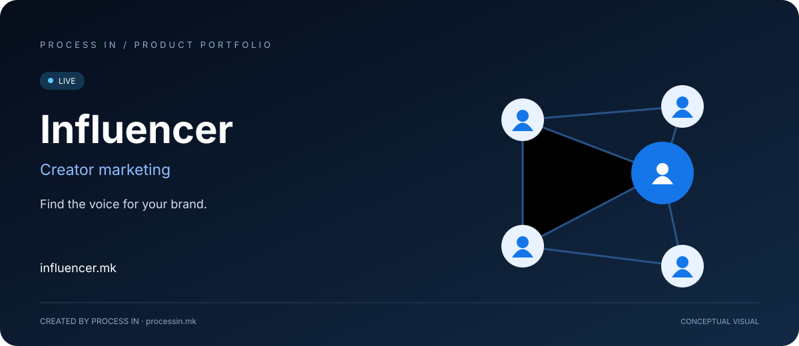

# Influencer

[Македонски](README.mk.md) · [English](README.md) · [Shqip](README.sq.md) · [Türkçe](README.tr.md)

**Markanızın sesini bulun.**

**LIVE**

## Kampanyanın kitlesiyle başlayın. Uygun içerik üreticisini bulun.

İçerik üreticisi arayan marka, iş birliğini seçmeden önce konuyu, yaratıcı teklifi ve hedef kitle uyumunu anlamalıdır. Üreticinin de teklifini sosyal medya kullanıcı adından daha fazla bağlamla, profesyonel bir iş olarak sunacağı bir yere ihtiyacı vardır.

Influencer içerik üreticisi keşfini, hizmet tekliflerini ve kampanya ilanlarını bir araya getirir. Markaları kampanya ihtiyacından ilgili profillere yönlendirirken üreticilerin sundukları içerik türünü tanıtmalarını sağlar.

## Nasıl başlanır

| Adım | İşlem |
|---|---|
| 01 | İçerik üreticilerini keşfedin |
| 02 | Profilleri ve hizmetleri inceleyin |
| 03 | Kampanya briefini belirleyin |
| 04 | Platformun iş birliği sürecini izleyin |

## Temel özellikler

| Alan | Sunduğu |
|---|---|
| **Üretici keşfi** | Influencer profillerini inceleyin. |
| **Kampanyalar** | Kampanya ilanlarını keşfedin. |
| **Hizmetler** | Üreticilerin hizmet tekliflerini değerlendirin. |
| **Kitle uyumu** | Üreticinin konusunu marka briefiyle karşılaştırın. |
| **Yaratıcı kapsam** | Hizmet açıklamalarıyla teklifi anlayın. |
| **Destek** | Yardım için platformla iletişime geçin. |

## Kimlere, hangi konuda yardımcı olur

| Kullanıcılar | Pratik kullanım |
|---|---|
| **Markalar** | Ürün ve hedef kitleye göre üretici ve hizmet arar. |
| **Pazarlama ekipleri** | Yön belirlemeden önce yaratıcı kapsamı kampanya briefiyle karşılaştırır. |
| **İçerik üreticileri** | Hizmet tekliflerini sunar ve pazar yerinin kampanya tarafını inceler. |

## Gerçek kullanım durumları

### Cilt bakım ürünü lansmanı

İlgili güzellik içeriklerini inceleyin; ürün, hedef kitle ve gereken içeriği kapsayan bir brief hazırlayın.

### Teknoloji kampanyası planlama

Kampanya kapsamını konuşmadan önce profilleri ve hizmet açıklamalarını ürünle ilgilerine göre karşılaştırın.

## Neden bu çözüm değerlendirilmeli

Anlamlı karşılaştırma, brief ile üreticinin teklifinin uyumudur. Profiller, hizmetler ve kampanyalar bu bağlamın farklı parçalarını sunar. Açık gereksinimler markanın uygunluğu değerlendirmesine, üreticinin ise iş birliğinin ne üretmesi gerektiğini anlamasına yardımcı olur.

## Ürün bilgileri

| Ayrıntı | Değer |
|---|---|
| Web sitesi | [influencer.mk](https://influencer.mk/) |
| Kategori | İçerik üreticisi pazarlaması |
| Durum | LIVE |
| Geliştirici | [PROCESS IN](https://processin.mk) |
| Portföy iletişimi | [contact@processin.mk](mailto:contact@processin.mk) |

Sunum kaynakları: [1](https://influencer.mk/).

### [Ziyaret edin: Influencer](https://influencer.mk/)

[PROCESS IN — Your Enterprise Software & AI Partner](https://processin.mk)

---

Herkese açık ürün sunumu. Özel uygulama kodu veya müşteri verisi içermez.

---

This platform is a digital product of <a href="https://processin.mk" target="_blank" >PROCESS IN </a>· Your Enterprise Software & AI Partner ·  Hosted on Enterprise Infrastructure by <a href="https://inhost.mk" target="_blank">INHOST</a>·
